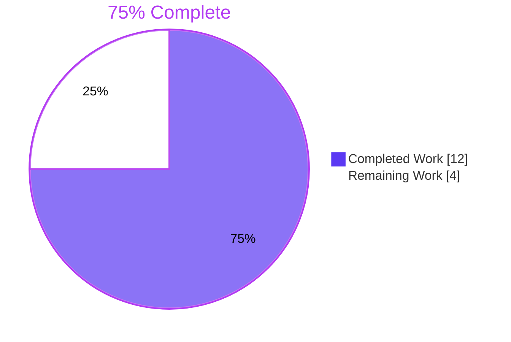
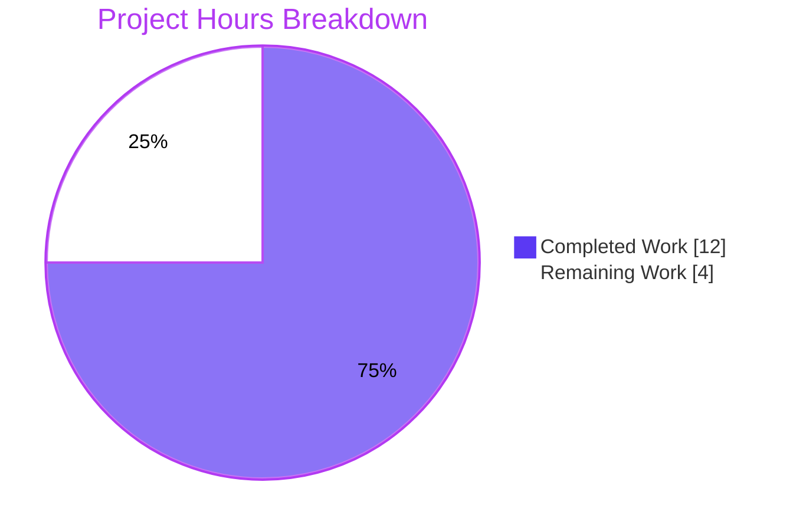
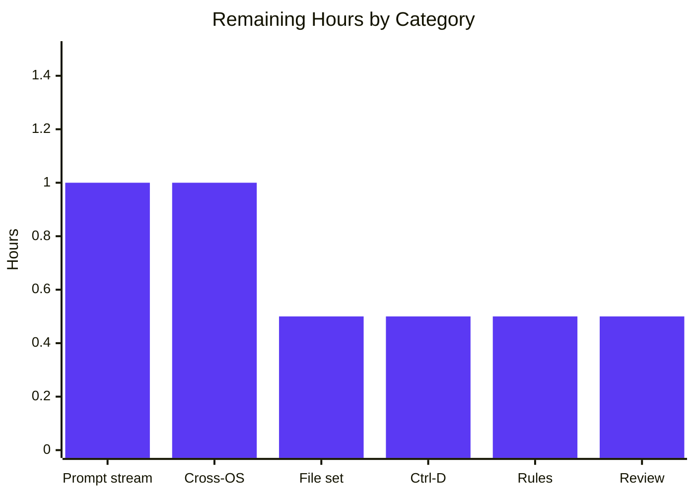

# 1. Executive Summary

## 1.1 Project Overview

This project delivers two independent, standard-library-only Python 3 command-line scripts at the repository root: `is_prime.py` tells whether a whole number is prime, and `sqrt_any.py` prints the square root of a real number, imaginary for negatives. Both serve developers and learners at a terminal, read one line from standard input, reject bad input with a one-line message and exit status 1, and fit in 18 lines each. There is no service, package, configuration or data store; each script is its own entry point on CPython 3.6 or later.

## 1.2 Completion Status



| Metric | Value |
|---|---|
| Total Hours | 16 |
| Completed Hours (AI + Manual) | 12 (12 AI + 0 manual) |
| Remaining Hours | 4 |
| Percent Complete | 75% (12 ÷ 16 × 100) |

## 1.3 Key Accomplishments

- [x] `is_prime.py` and `sqrt_any.py` match the planned 18-line sources verbatim, with no imports beyond `cmath` and `math`
- [x] Every row of the acceptance run tables passes on CPython 3.13.7 and 3.12.3 (39 of 39 on each)
- [x] Prime verdicts agree with an independent sieve for every integer from −100 to 2000
- [x] Square roots are bit-exact against `math.sqrt` for −500 to 500, with purely imaginary roots for negatives
- [x] Byte-identical output on CPython 3.6.15 through 3.14.8
- [x] Code and shell injection payloads are rejected as data; control characters are escaped in error lines
- [x] Static gate clean: 18 lines each, ASCII/LF, and flake8, pycodestyle and pyflakes are silent
- [x] Only the two scripts were added; `README.md` is unchanged and no `__pycache__` or other file was created

## 1.4 Critical Unresolved Issues

Five items remain open. None blocks release on Linux: 0 of 2 scripts fails an acceptance check, and 1 of the request's 9 directives ("exactly two files") carries a caveat. All five are detailed in Section 5.2.

| Issue | Impact | Owner | ETA |
|---|---|---|---|
| Repository also holds the pre-existing `README.md` (plus two empty untracked directories), so the file-inventory check lists three files, not two | Literal acceptance check differs; no functional effect | Repository owner | 0.5 h |
| At an interactive terminal (stdin and stdout both a tty), CPython writes the prompt to stderr, not stdout | A user who redirects stderr (`2>log`) sees no prompt | Repository owner | 1.0 h |
| In a terminal, a line ended with Ctrl-D instead of Enter loses its last character (`16` is read as `1`) | Rare interactive misread; piped input unaffected | Repository owner | 0.5 h |
| The "any OS" portability claim is verified on Linux only; Windows and macOS were never run | Unconfirmed behaviour for users on those platforms | Repository owner | 1.0 h |
| Compliance rests on the request's directives and AAP 0.9's record that no user rules exist; no other rules source was consulted | Any house rule kept elsewhere is unapplied | Repository owner | 0.5 h |

## 1.5 Access Issues

No access issues identified. The interpreters, lint tools, Docker images and git branch used for verification were all reachable.

## 1.6 Recommended Next Steps

1. [Medium] Decide how the prompt should behave at an interactive terminal: accept CPython's behaviour, or amend both line maps and re-run the acceptance gate.
2. [Medium] Run the acceptance table on Windows and macOS CPython to confirm the "any OS" portability claim.
3. [Low] Decide whether `README.md` stays, given the two-file inventory check.
4. [Low] Confirm no project rules document exists beyond AAP 0.9, then review and merge.

# 2. Project Hours Breakdown

## 2.1 Completed Work Detail

| Component | Hours | Description |
|---|---|---|
| `is_prime.py` prime check (FR-1, FR-3, FR-4) | 2.0 | Stdin read and strip, `int()` parse with one-line `SystemExit` rejection, trial division bounded by `divisor * divisor <= n`, values below 2 not prime, single conditional result print |
| `sqrt_any.py` square root (FR-2, FR-3, FR-4) | 2.0 | `float()` parse with rejection, `x < 0` routes to `cmath.sqrt` (imaginary root), everything else including `inf` and `nan` to `math.sqrt`, echo of the stripped input |
| Static compliance (AAP 0.10, 0.12.1, 0.12.3 static block) | 1.0 | Line counts, line-1 comments, import and definition greps, comment and docstring counts, 79-column limit, ASCII/LF format, `compile()` on two interpreters, PEP 8 lint |
| Runtime acceptance (AAP 0.12.3) | 2.5 | Both run tables, the integer-limit case under both policies, both empty-stdin cases, parity on 3.12.3, and oracle sweeps for both scripts |
| Security NFR verification | 2.0 | Injection and terminal-escape payloads, confirmation that input reaches only `int()`/`float()` and that no file, network or subprocess activity occurs |
| Performance NFR verification | 1.0 | √n scaling of trial division against the AAP 0.2.1 timings, constant-time square root, long-input behaviour |
| Portability verification (CPython 3.6+) | 1.5 | Identical smoke output across CPython 3.6.15, 3.7.17, 3.8.20, 3.9.25, 3.10.22, 3.11.17, 3.12.15, 3.13.16, 3.14.8, host 3.13.7 and 3.12.3 |
| **Total** | **12.0** | |

## 2.2 Remaining Work Detail

| Category | Hours | Priority |
|---|---|---|
| Interactive prompt stream: accept CPython's tty behaviour or amend the AAP line maps and re-run the gate | 1.0 | Medium |
| Cross-OS verification: run the acceptance table on Windows and macOS CPython | 1.0 | Medium |
| File-set decision: keep or remove the pre-existing `README.md` | 0.5 | Low |
| Ctrl-D line-ending behaviour at a terminal: accept and document, or amend the AAP | 0.5 | Low |
| Rules confirmation: verify no project rules exist beyond AAP 0.9 and apply any that do | 0.5 | Low |
| Code review and merge | 0.5 | Low |
| **Total** | **4.0** | |

## 2.3 Hours Calculation

- Completed: 2.0 + 2.0 + 1.0 + 2.5 + 2.0 + 1.0 + 1.5 = **12.0 hours**
- Remaining: 1.0 + 1.0 + 0.5 + 0.5 + 0.5 + 0.5 = **4.0 hours**
- Total: 12.0 + 4.0 = **16.0 hours**
- Completion: 12.0 ÷ 16.0 × 100 = **75%**

Confidence is high for completed work, which is small and fully exercised. Remaining estimates carry medium confidence: the prompt-stream item grows if the owner chooses to amend the line maps, because both scripts must then be re-verified against the full acceptance table.

# 3. Test Results

The request forbids test files, so the project has no unit test suite and no coverage tooling. Verification is the AAP 0.12.3 acceptance gate plus targeted harnesses kept outside the repository. Every count below was observed in a run against the delivered scripts.

| Area / Category | Framework | Tests | Passed | Failed | Coverage | What This Proves |
|---|---|---|---|---|---|---|
| Static acceptance gate (AAP 0.10, 0.12.3) | shell, `compile()`, flake8 7.4.1, pycodestyle 2.15.0, pyflakes 4.0.3 | 18 | 18 | 0 | Both files, every line | Both files are 18-line, ASCII/LF, PEP 8-clean, standard-library-only scripts with no functions, classes or docstrings; the inventory lists the two scripts plus the pre-existing `README.md` |
| Acceptance run tables, CPython 3.13.7 | Python `subprocess` harness | 39 | 39 | 0 | Every AAP 0.12.3 row | Every specified input yields the exact stdout, stderr and exit status, including both integer-limit branches and empty stdin |
| Acceptance run tables, CPython 3.12.3 | Python `subprocess` harness | 39 | 39 | 0 | Every AAP 0.12.3 row | Behaviour on the AAP's planning interpreter is byte-identical |
| Prime oracle sweep | Sieve oracle | 2101 | 2101 | 0 | All integers −100..2000 | Every verdict is correct, including 0, 1, negatives and perfect squares |
| Square-root oracle sweep | `math.sqrt` bit-exact comparison | 1001 | 1001 | 0 | All integers −500..500 | Roots are exact; negatives give a purely imaginary root in `j` form |
| Portability matrix | Docker `python:*-slim` images | 9 | 9 | 0 | 22-input smoke set per interpreter | Output on CPython 3.6.15 to 3.14.8 is identical to the host |
| Input-safety payloads | shell harness | 14 | 14 | 0 | 7 payloads × 2 scripts | Expressions, shell substitutions and escape sequences are rejected as data, escaped, and execute nothing |

**Not Covered**

- **Windows and macOS.** Every run was on Linux. AAP 0.1.1 claims any OS; run the acceptance table there before release to those users.
- **Interactive-terminal edge cases.** The prompt-to-stderr behaviour under a tty and the Ctrl-D line-ending behaviour were observed but are not part of any repeatable gate (Section 5.2).
- **Regression protection.** No automated suite guards future edits; any change must re-run the static block and both run tables by hand.

# 4. Runtime Validation & UI Verification

Both scripts were driven as real processes from the repository root. There is no web UI, authentication or external integration, so no browser session applies.

- ✅ **Start-up and entry points** — `python3 is_prime.py` and `python3 sqrt_any.py` run directly by pipe, here-string and redirect; `printf '7\n' | python3 is_prime.py` prints `Enter a whole number: 7 is prime.` and exits 0.
- ✅ **Prime check flow** — primes, non-primes, signs, leading zeros, underscores, surrounding spaces and Unicode digits (`٧` → `7 is prime.`) all produce the specified line.
- ✅ **Square-root flow** — `16` → `4.0`, `-4` → `2j`, `-0` → `-0.0`, `1e400` → `inf`, `-inf` → `infj`, `nan` → `nan`, and `2^53 + 1` prints the same root as `2^53`.
- ✅ **Input rejection** — `7.0`, `abc`, `it's`, `3+4j` and empty lines print one `Invalid input: …` line on stderr, no traceback, exit 1.
- ✅ **Integer-limit policy** — a 5000-digit input is rejected under the default 4300-digit limit (exit 1) and checked as not prime with `PYTHONINTMAXSTRDIGITS=0` (exit 0).
- ✅ **Empty stdin** — both scripts print the prompt, then the `EOFError` traceback, exit 1, exactly as AAP 0.5.1 specifies.
- ⚠ **Interactive terminal** — typed input gives correct results, but with stdin and stdout both a tty the prompt is written to stderr, and a line ended with Ctrl-D loses its last character (Section 5.2).
- ⚠ **Very large primes** — correct but unbounded: `1000000000000000003` was still running when stopped at 5 s, the slowness AAP 0.5.1.1 accepts.
- ✅ **Side effects** — no run created any file; `git status --porcelain --ignored` stays empty and no `__pycache__/` appears.
- ❌ **Never exercised** — Windows and macOS interpreters; all runtime evidence is from Linux.

# 5. Compliance & Quality Review

## 5.1 Compliance Matrix

| AAP Deliverable / Benchmark | Source | Status | Progress | Evidence |
|---|---|---|---|---|
| `is_prime.py` per line map and output spec | AAP 0.5.1.1 | ✅ Pass | 100% | `is_prime.py:1-18`; 21 table rows and 2101-case sweep |
| `sqrt_any.py` per line map and output spec | AAP 0.5.1.2 | ✅ Pass | 100% | `sqrt_any.py:1-18`; 18 table rows and 1001-case sweep |
| Input rejection: one stderr line, exit 1, no traceback | FR-3, AAP 0.5.1 | ✅ Pass | 100% | `is_prime.py:5-8`, `sqrt_any.py:7-10` |
| File name comment on line 1 | FR-4 | ✅ Pass | 100% | `head -n 1` on both files |
| 15–20 lines per file, 79-column limit, ASCII/LF | Request, AAP 0.12.1 | ✅ Pass | 100% | `wc -l` 18/18; `awk 'length > 79'` empty |
| Standard library only, no manifest | Request, AAP 0.4.1 | ✅ Pass | 100% | Only `sqrt_any.py:3-4` import `cmath`, `math` |
| No functions, classes or excluded features | Request, AAP 0.7.2 | ✅ Pass | 100% | def/class/lambda grep empty; EOF left unhandled |
| Comments and docstrings as planned | AAP 0.12.1 | ✅ Pass | 100% | 3 comments, 0 docstrings per file |
| PEP 8 lint | AAP 0.12.1 | ✅ Pass | 100% | flake8, pycodestyle, pyflakes silent |
| Repository holds only the two scripts | AAP 0.6.1, 0.10 | ⚠ Caveat | 95% | Only two files added; pre-existing `README.md` remains |
| Process contract: prompt on stdout | AAP 0.3.3 | ⚠ Caveat | 95% | Holds for pipes and redirects; tty/tty sends it to stderr |
| Security and portability NFRs | AAP 0.1.1 | ⚠ Caveat | 90% | Payloads rejected; CPython 3.6–3.14 identical on Linux only |

## 5.2 AAP & Rule Divergences and Gaps

| What the AAP/Rule Required | What Was Delivered Instead | Why It Diverged | Impact | Remediation |
|---|---|---|---|---|
| Repository holds exactly `./is_prime.py` and `./sqrt_any.py` (AAP 0.6.1, 0.10, 0.12.3) | Inventory also lists `./README.md`; two empty untracked directories exist under `blitzy/` | `README.md` pre-dates the work (commit `0b8f5a1`) and was preserved untouched | Literal inventory check prints three files; no runtime effect | Owner keeps or removes `README.md` |
| Prompt written to stdout with no newline (AAP 0.2.3, 0.3.3) | With stdin and stdout both a tty, CPython writes the prompt to stderr | CPython `input()` behaviour; the AAP fixes line 4/6 as `input(prompt)` | Interactive users who redirect stderr lose the prompt | Accept, or amend line maps and re-verify |
| One line read per run, typed or piped (AAP 0.5.1, 0.5.4) | A typed line ended by Ctrl-D drops its last character | CPython tty line handling under `input()`; EOF handling is excluded by AAP 0.7.2 | Rare misread at a terminal; pipes unaffected | Accept and document, or amend the AAP |
| Runs on CPython 3.6 or later on any OS (AAP 0.1.1, 0.3.1) | Verified on Linux across CPython 3.6.15–3.14.8 only | Windows and macOS runs were not carried out in this run | Platform-specific behaviour unconfirmed | Run the acceptance table on both platforms |
| Apply all user-specified rules (AAP 0.9) | Compliance held to the request's 9 directives and AAP 0.12.1 | AAP 0.9 records that no user rules were provided; no other rules source was consulted | Any house rule kept elsewhere is unapplied | Owner confirms no other rules apply |

**File set.** AAP 0.1.1 assumed an empty working directory that was not a git repository, and AAP 0.12.3 expects `find . -path ./.git -prune -o -type f -print` to print exactly the two scripts. The repository instead began at commit `0b8f5a1` with a 2-line `README.md`, which was kept unchanged; `git diff 0b8f5a1 HEAD -- README.md` is empty, and commit `e467b04` adds only the two scripts. The directories `blitzy/screenshots` and `blitzy/screen_recordings` are empty and untracked, so neither git nor the inventory sees them. Neither script is affected. The owner should decide whether `README.md` belongs in a repository whose request said "Output only the two code blocks".

**Prompt stream at an interactive terminal.** AAP 0.2.3 and 0.3.3 say `input()` writes its prompt to stdout. That holds for every piped or redirected run, but when stdin and stdout are both terminals CPython writes the prompt to stderr; this was observed on 3.13.7 and 3.12.3 for both scripts. So `python3 is_prime.py 2>log` at a terminal hides the prompt, although the result still appears. The AAP fixes `is_prime.py:4` and `sqrt_any.py:6` as `input("…").strip()`, so any change means amending the plan, for example printing the prompt with `print(..., end="", flush=True)` before calling `input()`, still within 20 lines.

**Ctrl-D line ending.** AAP 0.5.1 chooses `input()` and deliberately leaves end-of-input unhandled. At a terminal, a line finished with Ctrl-D rather than Enter is passed to the script without its last character: typing `16` then Ctrl-D prints `sqrt(1) = 1.0`. This is CPython's tty input path, not script logic, and piped input is unaffected. The echoed text shows what was evaluated, which limits confusion. Reading stdin another way would need an import that AAP 0.4.1 does not allow in `is_prime.py`. The owner should accept and document this, or amend the AAP.

**Cross-platform verification.** AAP 0.1.1 promises CPython 3.6 or later "on any OS". Every run behind this assessment was on Linux: the acceptance table on 3.13.7 and 3.12.3, and an identical 22-input smoke set on nine CPython releases from 3.6.15 to 3.14.8. Windows and macOS were not run. The scripts use only `input()`, `int()`, `float()`, `math`, `cmath` and `print()`, so platform differences are unlikely, but console encoding and line endings on Windows are untested. Running the table once on each platform, about one hour, closes the gap.

**Rule source.** AAP 0.9 states that no user-specified rules were provided, so the work was held to the nine directives in the request (AAP 0.1.2, 0.10) and the AAP 0.12.1 guidelines, all of which pass. No other rules source was consulted, so the user-rule count rests on the AAP's own record. If the owner keeps house rules elsewhere, such as a team style guide, a half-hour check of `is_prime.py`, `sqrt_any.py` and the file set against them closes this gap.

# 6. Risk Assessment

| Risk | Category | Severity | Probability | Mitigation | Status |
|---|---|---|---|---|---|
| Large primes run without bound (a 19-digit prime takes well over a minute) and the script has no timeout | Technical | Low | Medium | Callers feeding untrusted or large input wrap runs in `timeout`; faster algorithms are excluded by AAP 0.7.2 | Accepted (AAP 0.5.1.1) |
| Integer-string guard can be disabled (`PYTHONINTMAXSTRDIGITS=0`) or is absent on 3.6 and on releases before 3.7.14, 3.8.14, 3.9.14 and 3.10.7, exposing CVE-2020-10735-class parse cost (10 MB input: about 23 s, 70 MB) | Security | Low | Low | Run on a patched interpreter with the default 4300-digit limit | Accepted |
| Output and memory grow with input because the input is echoed (10 MB line → about 10 MB output, 38–48 MB RSS); right-to-left or look-alike Unicode digits are echoed as typed | Operational | Low | Low | Local single-user CLI; cap input size upstream if exposed to other users | Accepted (AAP 0.3.2, 0.5.1.2) |
| Empty stdin, Ctrl-C and undecodable bytes under strict `PYTHONIOENCODING` produce a traceback that shows the script's absolute path | Security | Low | Medium | Informational only; handlers are excluded by AAP 0.5.1 and 0.7.2 | Accepted |
| Interactive prompt goes to stderr when stdin and stdout are both terminals | Integration | Low | Medium | Decide per Section 5.2; document for terminal users | Open |
| A Ctrl-D-terminated line at a terminal loses its last character | Operational | Low | Low | Document that input must end with Enter | Open |
| Never run on Windows or macOS despite the "any OS" portability claim | Integration | Medium | Low | Run the acceptance table on both platforms before targeting their users | Open |
| No automated regression suite, as the request forbids tests | Technical | Low | Medium | Re-run the documented static block and both run tables after any edit (Section 9) | Accepted |

# 7. Visual Project Status



Remaining hours by category (Section 2.2), 4.0 hours in total:



| Priority | Tasks | Hours |
|---|---|---|
| High | 0 | 0.0 |
| Medium | 2 | 2.0 |
| Low | 4 | 2.0 |
| **Total** | **6** | **4.0** |

# 8. Summary & Recommendations

The project is 75% complete: 12 of 16 hours are delivered and the remaining 4 hours are owner decisions and one cross-platform check, not code. Both deliverables, `is_prime.py` and `sqrt_any.py`, exist at the repository root in one commit (`e467b04`, 36 lines added). Each matches its planned 18-line source line for line, uses only the standard library, and defines no function or class. Nothing else was added to the repository.

Verification is thorough for scripts of this size. Every row of the acceptance run tables passes on CPython 3.13.7 and 3.12.3, 39 of 39 on each, including both integer-limit branches and the empty-stdin case. An independent sieve agrees with all 2101 prime verdicts from −100 to 2000. Square roots for −500 to 500 are bit-exact. Output is identical on every CPython release from 3.6.15 to 3.14.8, and injection and escape payloads are rejected as data. The static gate is clean.

Five open items remain, all caveats rather than defects. The file inventory also lists the pre-existing `README.md`. At an interactive terminal, CPython sends the prompt to stderr, and a Ctrl-D-terminated line loses its last character. Windows and macOS have never been exercised. The rule set rests on AAP 0.9's statement that no user rules exist.

Critical path to production: (1) decide the interactive prompt behaviour, and if the line maps change, re-run the full acceptance table; (2) run the table once on Windows and macOS; (3) settle `README.md` and confirm no other rules apply; (4) review and merge. Success means the static block prints exactly the expected values, every run-table row matches on each target platform, and `git status --porcelain --ignored` stays empty.

Production readiness: ready for its stated scope, a local single-run CLI on CPython 3.6 or later on Linux. Callers that pipe untrusted or very large input should wrap runs in `timeout`, because trial division on very large primes is slow by design.

# 9. Development Guide

## 9.1 System Prerequisites

- CPython 3.6 or later on `PATH` as `python3` (verified on 3.6.15 through 3.14.8; primary development interpreter 3.13.7).
- A POSIX shell with `printf`, `find`, `grep`, `awk`, `wc`, `file` and `git`.
- Optional: flake8 7.x for linting, and Docker for the multi-version portability check.
- No third-party packages, manifests, services, ports, databases or credentials are needed.

## 9.2 Environment Setup

There is nothing to install. Work from the repository root and keep the checkout free of generated files, because the file-inventory check counts every file:

```bash
export PYTHONDONTWRITEBYTECODE=1
python3 --version
```

- Do not create a virtual environment, `.gitignore`, manifest or test file inside the checkout. If you need flake8, install it into a virtual environment located outside the repository.
- Never run `py_compile`, `python -m compileall` or `import is_prime`, which write `__pycache__/`. Use the `compile()` one-liner below for syntax checks.

## 9.3 Running the Scripts

Each script reads one line from standard input. Pipe the input or type it at the prompt:

```bash
printf '7\n' | python3 is_prime.py
# Enter a whole number: 7 is prime.

python3 is_prime.py <<< 97
# Enter a whole number: 97 is prime.

printf "it's\n" | python3 is_prime.py; echo "exit=$?"
# stdout: Enter a whole number:
# stderr: Invalid input: "it's" is not a whole number.
# exit=1

echo 2.25 | python3 sqrt_any.py
# Enter a number: sqrt(2.25) = 1.5

printf '%s\n' '-0.25' | python3 sqrt_any.py
# Enter a number: sqrt(-0.25) = 0.5j

printf '3+4j\n' | python3 sqrt_any.py; echo "exit=$?"
# stderr: Invalid input: '3+4j' is not a number.
# exit=1
```

## 9.4 Verification: Static Gate

Run from the repository root; expected results are in the comments:

```bash
find . -path ./.git -prune -o -type f -print | sort    # ./README.md ./is_prime.py ./sqrt_any.py
wc -l is_prime.py sqrt_any.py                          # 18 each
head -n 1 is_prime.py sqrt_any.py                      # "# is_prime.py" / "# sqrt_any.py"
grep -nE '^\s*(import|from) ' is_prime.py sqrt_any.py  # sqrt_any.py:3:import cmath, sqrt_any.py:4:import math
grep -nE '^\s*(async def|def|class) |lambda' is_prime.py sqrt_any.py   # no output
grep -c '^#' is_prime.py sqrt_any.py                   # 3 each
grep -cE "\"\"\"|'''" is_prime.py sqrt_any.py          # 0 each
awk 'length > 79' is_prime.py sqrt_any.py              # no output
python3 -c "import sys; [compile(open(f, encoding='utf-8').read(), f, 'exec') for f in sys.argv[1:]]" is_prime.py sqrt_any.py
file is_prime.py sqrt_any.py                           # ASCII text
flake8 --max-line-length=79 is_prime.py sqrt_any.py    # no output (optional)
git status --porcelain --ignored                       # no output
```

## 9.5 Verification: Runtime Cases

```bash
# Integer-string limit in force: 4300 on patched interpreters (3.11+, 3.10.7+,
# 3.9.14+, 3.8.14+, 3.7.14+); 0 means no limit or limit disabled
python3 -c "import sys; print(getattr(sys, 'get_int_max_str_digits', lambda: 0)())"

# 5000-digit composite: rejected under the default limit (exit 1) ...
python3 -c "print('1' * 4999 + '0')" | python3 is_prime.py > /dev/null; echo "exit=$?"
# ... and checked when the limit is disabled (ends "is not prime.", exit 0)
python3 -c "print('1' * 4999 + '0')" | PYTHONINTMAXSTRDIGITS=0 python3 is_prime.py | tail -c 20

# Empty stdin: prompt, then an EOFError traceback, exit 1 (by design)
python3 sqrt_any.py < /dev/null; echo "exit=$?"

# Portability spot check on an older interpreter (requires Docker)
docker run --rm -i -v "$PWD":/w:ro -w /w -e PYTHONDONTWRITEBYTECODE=1 python:3.6-slim python3 is_prime.py <<< 7
# Enter a whole number: 7 is prime.
```

Repeat every input from the AAP 0.12.3 tables as `printf '%s\n' '<input>' | python3 <file>`, comparing stdout, stderr and the exit status. After any edit, re-run both the static gate and these cases.

## 9.6 Troubleshooting

| Symptom | Cause | Resolution |
|---|---|---|
| `__pycache__/` appears in the checkout | A command compiled or imported a script | Delete it, export `PYTHONDONTWRITEBYTECODE=1`, and use the `compile()` one-liner |
| `error: externally-managed-environment` when installing flake8 | System Python is PEP 668-managed | Install flake8 into a virtual environment outside the repository |
| No prompt visible when stderr is redirected at a terminal | CPython writes the `input()` prompt to stderr when stdin and stdout are both terminals | Do not redirect stderr interactively, or pipe the input (Section 5.2) |
| A typed number is read without its last digit | The line was ended with Ctrl-D instead of Enter | Press Enter to submit the line |
| `is_prime.py` appears to hang | Trial division on a very large prime is slow by design | Wrap the run: `timeout 10 python3 is_prime.py` |
| Long number rejected as "not a whole number" | More than 4300 digits under the interpreter's integer-string limit | Set `PYTHONINTMAXSTRDIGITS=0` for that command only |
| `EOFError` traceback | No input line was supplied | Pipe or type a value; this behaviour is specified by AAP 0.5.1 |

# 10. Appendices

## A. Command Reference

| Purpose | Command (from the repository root) |
|---|---|
| Run the prime check | `printf '7\n' \| python3 is_prime.py` |
| Run the square root | `printf '16\n' \| python3 sqrt_any.py` |
| Syntax check without bytecode | `python3 -c "import sys; [compile(open(f, encoding='utf-8').read(), f, 'exec') for f in sys.argv[1:]]" is_prime.py sqrt_any.py` |
| Lint | `flake8 --max-line-length=79 is_prime.py sqrt_any.py` |
| File inventory | `find . -path ./.git -prune -o -type f -print \| sort` |
| Hygiene check | `git status --porcelain --ignored` |
| Disable the integer limit for one run | `PYTHONINTMAXSTRDIGITS=0 python3 is_prime.py` |
| Bound a long run | `timeout 10 python3 is_prime.py` |

## B. Port Reference

Not applicable: neither script opens a port or a network connection.

## C. Key File Locations

| Path | Purpose |
|---|---|
| `is_prime.py` | Prime check: reads one whole number, prints `<n> is prime.` or `<n> is not prime.` (18 lines, no imports) |
| `sqrt_any.py` | Square root: reads one real number, prints `sqrt(<text>) = <root>`, imaginary for negatives (18 lines, imports `cmath`, `math`) |
| `README.md` | Pre-existing 2-line repository placeholder, unchanged |

## D. Technology Versions

| Component | Version |
|---|---|
| Minimum supported CPython | 3.6 (f-strings and underscore-tolerant parsing) |
| Primary verification interpreter | CPython 3.13.7 |
| Parity interpreter | CPython 3.12.3 |
| Portability matrix | CPython 3.6.15, 3.7.17, 3.8.20, 3.9.25, 3.10.22, 3.11.17, 3.12.15, 3.13.16, 3.14.8 |
| Lint tools | flake8 7.4.1, pycodestyle 2.15.0, pyflakes 4.0.3 |
| Standard-library modules used | `cmath`, `math` (in `sqrt_any.py` only) |

## E. Environment Variable Reference

Neither script reads environment variables. These interpreter settings affect how they run:

| Variable | Effect |
|---|---|
| `PYTHONDONTWRITEBYTECODE=1` | Prevents `__pycache__/` from being written during checks |
| `PYTHONINTMAXSTRDIGITS` | Interpreter integer-string limit; default 4300, `0` disables it, which lets `is_prime.py` accept inputs above 4300 digits |
| `PYTHONIOENCODING` | Setting a strict encoding such as `utf-8` turns undecodable input bytes into a traceback instead of a clean rejection |

## F. Developer Tools Guide

- **Change discipline.** Each file must stay within 15–20 lines, keep its line-1 file-name comment, and add no function, class, import or feature. Re-run the static gate (Section 9.4) and the runtime cases (Section 9.5) after any edit.
- **No test files.** The request forbids tests; keep any harness outside the repository.
- **Portability checks.** `docker run --rm -i -v "$PWD":/w:ro -w /w python:<version>-slim python3 <file>` runs a script read-only under another CPython release.

## G. Glossary

| Term | Meaning |
|---|---|
| Trial division | Primality test that checks divisors from 2 while `divisor * divisor <= n` |
| Integer-string limit | CPython's cap (default 4300 digits) on decimal string-to-int conversion, added as the CVE-2020-10735 mitigation |
| `repr()` quoting | Rendering of rejected text that quotes it and escapes control characters, e.g. `''` or `"it's"` |
| tty | An interactive terminal device, as opposed to a pipe or file |
